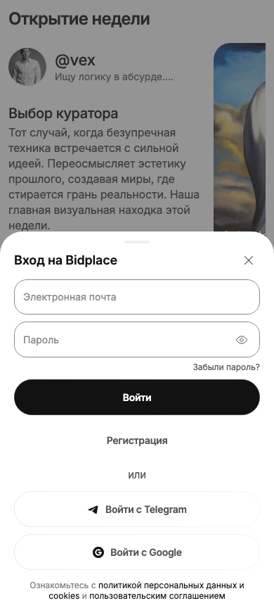
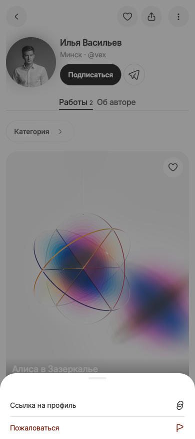

# Приёмка: фон входа и общий свайп шторок

Дата: 2026-10-18. Ветка: `fix/image-flicker`, база `386d1b7d`.
Диагностика: [IMAGE-FLICKER-AND-SHEETS](2026-10-18-IMAGE-FLICKER-AND-SHEETS.md).
Решение владельца: DEC-122. Scope: Expo/React Native Web, без изменения API/БД.

## Критерии и результат

| Критерий | Реализация / проверка |
| --- | --- |
| Вход поверх исходной страницы, без второй Home | Root/auth transparentModal, anchor index; HomeScreen удалён из AuthViewport. DOM-узлы img остаются подключены, количество не удваивается. |
| Закрытие сохраняет страницу и прокрутку | dismissTo + существующий безопасный return owner; guest FloatingDock передаёт текущий путь/query. Проверены Home и профиль автора. |
| Общий свайп за верхнюю область | SheetDragSurface + SheetDragHandle в AuthViewport, AppDialog, FilterSheet. Короткий жест возвращается, тело не закрывает окно. |
| Guard не теряет ввод и не закрывает занятую форму | Старый requestDismiss, drag disabled при busy; registration abort и Back/Forward проверены. |
| Клавиатура остаётся рабочей | Cross/Escape сохранены; useReturnFocus учитывает закрытие force-mounted sheet и быстрое повторное открытие. Share возвращает фокус на trigger. |
| Нет визуальных компенсаций | Нет translateZ/will-change/таймеров перезагрузки изображений. Цвета и геометрия не менялись; motion использует существующий токен и reduced motion. |

## Проверки

- Production web export: passed; свежая статика на <http://localhost:7899>, API
  <http://localhost:3001>. База данных сохранена, миграции/seed/reset не выполнялись.
- `tsc --noEmit`, eslint изменённых TS/TSX, prettier и diff-check: passed.
- Адресные unit: **53/53**, семь файлов — AppDialog web/native, theme,
  ResilientRemoteImage, sheet intent, floating dock, auth redirect.
- Browser acceptance: **12/12**, Chromium + WebKit. Синтетические данные для
  проверки identity изображений/busy; живой dev API для Home → профиль → login →
  профиль/share и works → filter → Back → authors.
- Браузер вручную: реальный вход в кабинет тестового автора, выход, профиль,
  login поверх профиля и закрытие ручкой; share закрывается жестом, фокус возвращён.
- После уточнения момента screenshot (stable header, без задержки по таймеру)
  live cases повторены: 4/4 Chromium + WebKit. Runtime не менялся.
- Точная команда ограниченного gate:

```sh
SHEET_TEST_URL=http://localhost:7899 pnpm --filter @bidplace/mobile exec playwright test \
  --config playwright.sheet-local.config.ts \
  -g 'login preserves the loaded|sheet closes by its header|busy login keeps|live Home keeps|live catalog, Back|after aborting a filled registration' \
  --workers=1
```

`sheet-live.spec.ts` требует уже работающий локальный сервер с демо-данными и
исключён из обычного isolated e2e gate. Этот config не запускает/не очищает БД.

## Открытые ограничения

- Дополнительный большой case `filled login closes without confirmation and
  providers stay unavailable` не прошёл в обоих движках: locator старого текста
  «политику конфиденциальности» отсутствует, сейчас ссылка «политикой персональных
  данных и cookies». Текст и legal API этой правкой не менялись. Полный auth suite
  зелёным не заявляется; baseline в отдельном браузере повторно не запускался.
- На промежуточном проходе найдены и исправлены: потерянный return path dock,
  busy/отложенное закрытие и старт тестового жеста на движущейся шапке. В тесте
  используется trial action для стабильного target, без ослабления assertions.
- Физический iPhone и native-приложение не проверены. Desktop WebKit не доказывает
  отсутствие всех GPU-артефактов Safari на устройстве; отдельная GPU-причина
  обычной навигации не подтверждена. Следующий шаг только при воспроизведении:
  видео/профиль конкретного устройства, без графических хаков заранее.
- Текущий bundle настроен на localhost API; прежний LAN URL не считается
  проверенным этой приёмкой. HTTPS/clipboard/PWA и TC-02 zoom не входили в фикс.
- Полные unit/e2e suites не запускались по просьбе экономить проверки.
- Push/merge/deploy не выполнялись; исходники находятся в отдельном worktree.

## Поддержка

Один общий gesture owner вместо обработчиков по экранам. Новая шторка использует
AppDialog/FilterSheet и указывает header; save/dirty/permissions остаются у владельца
потока. Серверные проверки и черновики не продублированы. Графический слой изображений
не усложнён. Массовая перестройка роутинга и смена SDK не нужны.

## Скриншоты

390 × 874 CSS px, production bundle, существующий light theme; это evidence
интеракций, а не новая Figma-приёмка геометрии. Файлы сохраняются рядом в
`evidence/2026-10-18-sheet-lifecycle/`.




