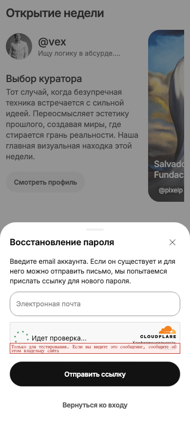

# Auth → forgot-password: проверка мигания

База: `576b2771`, ветка `fix/image-flicker`. Дата: 2026-10-19.

## Находка и варианты

В AuthViewport каждый маршрут создаёт собственное анимируемое затемнение.
Смена focused скрывает старый portal и запускает FadeIn нового; родительский
auth-layout при этом остаётся смонтирован. Предыдущая проверка открытия/закрытия
login не покрывала смену дочерних auth-маршрутов.

- Durable fix: один визуальный backdrop у auth-layout, а закрытие/focus/guards
  остаются в AuthViewport. Нет нового route-local обработчика или новой библиотеки.
- Acceptable workaround: убрать fade у отдельных маршрутов. Не гарантирует
  непрерывность слоя между сменами focused/portal.
- Hack: задержки, preload/opacity-патчи изображений. Не исправляют владельца слоя.

Критерии: login → forgot → login без изменения alpha затемнения на кадрах;
сохраняются нижняя страница, её img и scroll; Cross/свайп/Back/регистрация работают.
API, password reset, Turnstile, разрешения и БД не меняются. Отдельная ошибка
загрузки фона на скриншоте не доказывает причину мигания: localhost API проверяется
независимо. Результаты дополняются ниже.

## Красная регрессия

Два движка, реальный production bundle `576b2771`: оба упали в первом переходе
login → forgot. Минимальное измеренное затемнение **0** при ожидаемых **0,5**.
Измерение — 30 requestAnimationFrame samples с учётом opacity всех предков
у цветового слоя, покрывающего свободную точку экрана. Не заменено CSS zoom
или reduced-motion, не использованы sleeps/retries.

Выбран общий auth-layout backdrop (существующие semantic modalDimmer и motion).
Прозрачный Dialog.Overlay остаётся у активной формы и обслуживает dismiss;
визуальный слой не перезапускается при переходах между дочерними маршрутами.
Полноэкранная регистрация по-прежнему закрывает его непрозрачным canvas.

## Исправление и сопровождение

В `src/app/(auth)/_layout.tsx` один Animated.View использует существующие
`modalDimmer`, `sheetBackdropEnter/Exit` и StyleSheet.absoluteFill установленного RN.
Из AuthViewport удалена собственная fade-анимация затемнения; прозрачный
AppDialogOverlay сохранил обработку клика и тот же requestDismiss.

Новых зависимостей, context/state-менеджера и специальных правил forgot-password
нет. Следующий дочерний auth-экран автоматически пользуется тем же затемнением.
Проверки учётной записи, password reset, Turnstile, сервер и БД не менялись.

## Проверки (дополняется)

- Красный baseline: 2/2 падения на исчезновении затемнения.
- После исправления: 2/2 покадровых сценария (два перехода по 30 кадров в каждом
  браузере), alpha сохраняется около 0,5; изображения и scroll сохранены.
- Unit `AppDialog.spec.ts` + `auth-dismissal.spec.ts`: **22/22**.
- Production web export, mobile tsc и lint изменённых файлов: passed.
- Локальные web и API health: 200. Загрузка Home в браузере восстановлена;
  точная причина ошибки соединения на присланном скриншоте не установлена.
- На финальной приёмке дополнительно проверяются прежние swipe/close/Back/Forward
  сценарии; результаты записываются ниже.

Физический iPhone/native не проверены. Текущая web-сборка использует localhost API;
на реальном телефоне этот адрес не указывает на ноутбук. LAN/HTTPS-подключение —
отдельная настройка окружения, не обход ошибки загрузки в UI. TC-02 zoom и старый
большой auth/legal case из прошлого отчёта этой правкой не закрываются.

## Итоговая приёмка

**Implemented (web)**. Финальный bounded gate: **14/14**, Chromium + WebKit,
включая прежние image identity, swipe/body/короткий жест, busy, share/focus, filters,
Home/профиль/каталог и abort регистрации → Back/Forward.
Дополнительная регрессия сохраняет scroll=120 и уже загруженные img во время
login → forgot → login. На 30 кадрах каждого перехода в каждом движке effective
alpha остаётся в пределах **0,49–0,51**; baseline падал до **0** в обоих.

Runtime diff — только auth-layout и AuthViewport; оставшиеся добавления — регрессия
и документация. Полные suites не запускались. Новый цикл архитектурной миграции
не требуется: следующий auth-маршрут наследует постоянный визуальный слой.

Вручную в браузере: Home загрузилась, login → forgot открыл форму над той же
страницей, без новой Home; отправка reset-письма не выполнялась.
Скриншоты — `evidence/2026-10-19-auth-transition/`, это evidence взаимодействия,
а не пересмотр геометрии Figma. Сохранённые ограничения прошлого отчёта действуют.

