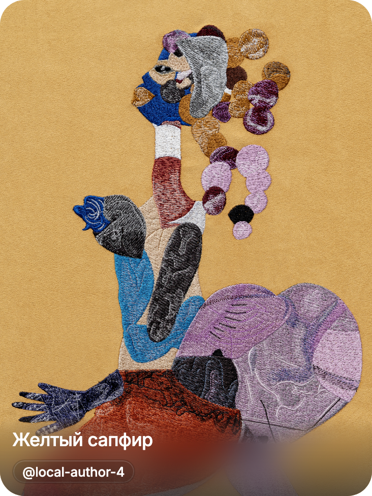
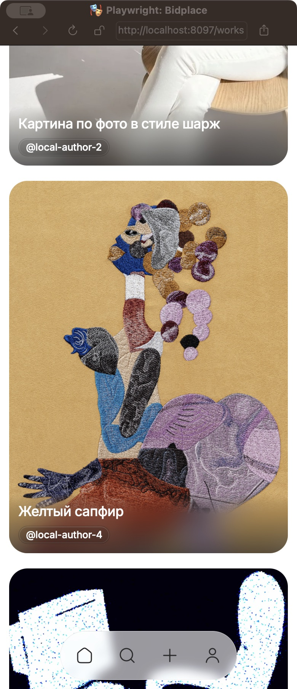
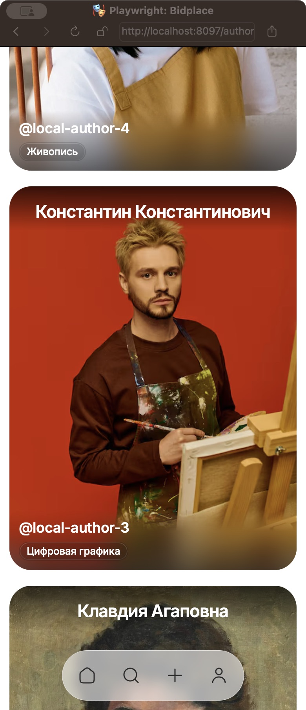

# Cover glass acceptance — 2026-10-25

Status: Implemented for verified web states; physical native acceptance Needs verification.
PR #66 base: `bfab51989f631936f03d06fbd8e6065339df275b`
(`feature/portfolio-mvp-release`); branch `fix/progressive-cover-blur`.
Intermediate experiment: `665752489e8c10476dadd8e42c18ed5ad2b11937`.
Runtime verification below targets `85ac01e08b662eeb854795dc86f46fc0de6cb723`.

## Scope and source

Founder-selected durable fix: shared `CoverFrost`, one web
`backdrop-filter: blur(16px) saturate(115%)`, transparent-to-opaque mask at35%,
independent existing two-stop Figma scrim. Author top has no blur. Content owns
panel height; bottom panel upper corners12, existing card radius/crop unchanged.
Text/chips are siblings of the decorative layers. No second source image,
WebGL, Canvas, SVG blur, stacked blur layers or dependencies.

Read-only live Figma `pAPQo6cADmG5XzVmBX76EE`: work874:5473 and author874:5552;
references retrieved through MCP. Compared the same artwork/author photographs
with live screenshots and the existing `/private/tmp/bidplace-frost-diagnosis/v4`
Blur16/Mask35 prototype. Deliberate differences: two-stop Figma scrim instead of
prototype's three stops; actual text-driven78/100px panels instead of fixed103px;
portfolio title/author rather than commerce labels. This is an approved visual
approximation, not exact Progressive Blur parity. Desktop composition stays
NEEDS-FIGMA; existing full-width catalog geometry was preserved.

Relative to the PR base, Native migrates from an additional `expo-image`
`Image` with `blurRadius=30` to supported
[Expo57 BlurView](https://docs.expo.dev/versions/v57.0.0/sdk/blur-view/):
`WorkCoverCard` / `AuthorCoverCard` wrap the existing sharp image in
`BlurTargetView`, then render the lower `BlurView` after it. Native uses
intensity60 (a platform intensity, not a CSS pixel radius), Android
`dimezisBlurViewSdk31Plus`, and tint/scrim fallback below SDK31. The additional
image is removed. This migration was introduced in intermediate commit
`66575248` and is part of PR #66; only the final tuning commit preserves that
intermediate native path. Physical iOS/Android rendering remains unverified.

Removed: unused `imageUrl` from both platform props/callers, unused frost aspect
ratio, blur string wrapper, obsolete progressive/top-zero tokens. Native intensity
has its own platform token so web tuning cannot change native behavior.
Shared card/image/retry/hover/navigation owners remain in place. Consumers:
Home opening/new works/new authors, Works/Authors catalogs, public author works,
related works and search work results; caption-only account cards are unchanged.
No API, persistence, product behavior, Dock or Explore changes; extension remains
owned by existing cards and tokens without a new renderer or format API.

## Verification

- Node22.20.0 / pnpm11.7.0; local dependencies installed from frozen lockfile.
  Initial node_modules symlinks pointed into a different checkout and produced
  missing datetimepicker/stale-package failures; replaced only local symlinks.
- `pnpm exec turbo run typecheck lint --filter=@bidplace/mobile...`:8/8 tasks PASS;
  lint without auto-fix. Expo startup regenerated stale ignored route types.
- `pnpm --filter @bidplace/mobile test`:145 files,1049/1049 PASS.
  Contracts48 and API-client51 tests PASS in affected graph checks.
- Theme regression passes8/8 on the actual PR base `bfab5198` (review replay in
  `/private/tmp/bidplace-pr66-review-base`). The Native migration in intermediate
  `66575248` introduced a missing `BlurTargetView` mock export; final runtime
  commit `85ac01e0` fixes it without weakening theme/remount assertions.
  The earlier `/private/tmp/bidplace-cover-baseline` replay used `66575248`,
  not the release base, and does not establish a pre-existing release failure.
- Review rerun on `85ac01e0`:38/38 relevant unit tests PASS. GitHub
  [Verify](https://github.com/yayauheny/bidplace/actions/runs/40144838621/job/121023856747)
  and GitGuardian completed successfully on that SHA; this is not a CI result
  for later documentation commits.
- `EXPO_NO_DOTENV=1 pnpm exec turbo run build --filter=@bidplace/mobile...`:
  4/4 PASS, web/iOS/Android exports. Successful exports do not prove device parity.
- Owner `figma-cover-frost.spec.ts`, Chromium and WebKit:2/2 PASS. Checks one
  source request per photograph, one img per card, one bottom filter, unblurred
  author top, mask/saturation, radii,78/100px text-driven panel, sharp text,
  loading/error placeholders and lower-panel geometry. Chromium blur-on/off
  pixel inequality retained. CSS color assertion now uses computed RGBA syntax.
- Actual `/works` and `/authors` routes, local public API with9 works/5 authors:
  Chromium/WebKit ×390/1024/1440 =12 checks PASS. Live resize, multiple photographs,
  lower-panel hover, scrolling, one image per sampled card, zero extra hover
  image requests, zero infinite web animations or page errors. These desktop
  browser checks do not establish phone frame times, native animation behavior
  or physical-device scroll performance. No new benchmark campaign.
- WebKit Playwright PNG omits composited backdrop blur. Verified visible WebKit
  through OS screenshots below: blur is present on both work and author bottoms.
  Computed-style assertions alone were not treated as visual proof.
- `pnpm docs:link-check` and `git diff --check`:PASS.
- Outstanding device acceptance: cold/delayed image load, image replacement,
  scrolling away/back through multiple cards, and brief catalog smoothness
  checks on physical iOS/Android. Native runtime and phone performance remain
  Needs verification; exports, request counts and desktop screenshots do not
  satisfy these checks.

## Native acceptance follow-up — 2026-10-25

**Needs verification.** Device access could not be established on this host:
`adb` is absent from PATH and standard Android SDK locations;
`xcode-select -p` points to `/Library/Developer/CommandLineTools`, and
`xcrun --find devicectl` reports the utility unavailable. No physical-device
runtime test was run. Export/browser results above do not replace it.

Installed `expo-blur` is 57.0.3. Upstream
[issue #51845](https://github.com/expo/expo/issues/51845) reports an Android
Modal/explicit-target backdrop becoming stale after background/resume on this
version. [Fix #51848](https://github.com/expo/expo/pull/51848) is still draft as of
2026-10-25. That reproduction does not establish a defect in these inline cards.
No dependency patch, upgrade or speculative resume/remount workaround is applied.

Physical iOS/Android acceptance must cover:

| Scenario | Expected result | Result |
| --- | --- | --- |
| Cold/delayed image load | Frost updates to the loaded photograph; text stays sharp | Needs verification |
| Photograph replacement in a mounted card | Sharp image and frost use the new photograph without stale content | Needs verification |
| Scroll through multiple cards, away and back | Correct photographs/backdrops, usable scrolling without persistent stalls | Needs verification |
| Open details and return/re-enter catalog | Card image, crop and frost restore correctly | Needs verification |
| Background the app and resume repeatedly, then scroll | No launch artwork, stale snapshot or disappearing blur; card controls still work | Needs verification |
| Android below SDK31 | Tint/scrim fallback remains readable without enabling the expensive blur path | Needs verification |

Web-first merge consideration must retain this explicit Native risk; this report
neither records founder acceptance of that risk nor establishes Native release
readiness. A simultaneous Native release still requires device acceptance.

## Explore integration procedure — executed 2026-10-25

Initial read-only comparison at `feature/explore-unification` SHA `b4e1d8e2` found five
shared files relative to release base `bfab5198`: `packages/design-tokens/src/tokens.ts`,
`docs/design/03-DESIGN-SYSTEM.md`, `docs/design/04-DESIGN-STATUS.md`,
`docs/product/10-CODE-ARCHITECTURE.md` and `docs/product/11-PROJECT-STATUS.md`.
These intersections are integration work, not a demonstrated runtime conflict.

1. After PR #66 is merged into `feature/portfolio-mvp-release`, synchronize
   `feature/explore-unification` with that updated MVP branch through its normal
   integration workflow. Do not manually copy the blur implementation first.
2. Preserve both token changes: `blur.cover=16`, `blur.coverNativeIntensity=60`
   from PR #66 and `stroke.icon=1.3`, `stroke.iconHeavy=1.6` from Explore.
   Do not restore removed `blur.authorTopOverlay` / `blur.coverProgressive` or
   discard unrelated Explore token changes when resolving the shared file.
3. Reconcile the four shared owner documents with both features and their actual
   verification results. Retain Native Needs verification until devices pass.
4. Run affected dependency-graph lint/typecheck/unit checks and the mobile build;
   run the existing cover-frost and Explore browser regressions in Chromium and
   WebKit. Verify Work/Author cards in the resulting Explore catalog use
   Blur16/Mask35 and the updated icon strokes.

The original follow-up did not perform a merge. Subsequent PR #67 integration
merged MVP `068af087` normally at `87a2ab68`: Blur16/Native60 and all Explore
icon roles are retained, old blur tokens absent, caption Works remain unfrosted.
Final integration checks are recorded in the [Explore audit](2026-10-25-EXPLORE.md).
Native device caveats above still apply. CI Verify and GitGuardian are green on pre-follow-up SHA `6633a3cd`:
[Verify](https://github.com/yayauheny/bidplace/actions/runs/40197074993/job/121180124822).
This is not a CI result for subsequent documentation commits.

## Screenshots

Chromium at390, same photographs as the Figma card references:

Visible WebKit OS captures (not Playwright element PNG):

Full local evidence: `/private/tmp/bidplace-cover-final`, including twelve
catalog screenshots, `catalog-checks.json` and `stabilization` state screenshots.
The temporary config targets the existing8097 web server and local3001 public
API; JSON responses were fulfilled with the test origin to respect the API's
existing origin allowlist. Server configuration and data were not modified.
